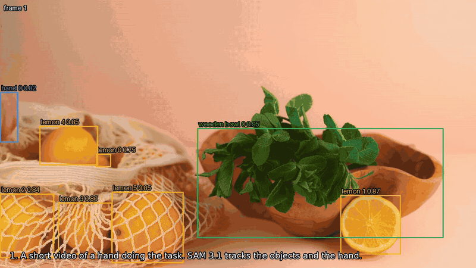
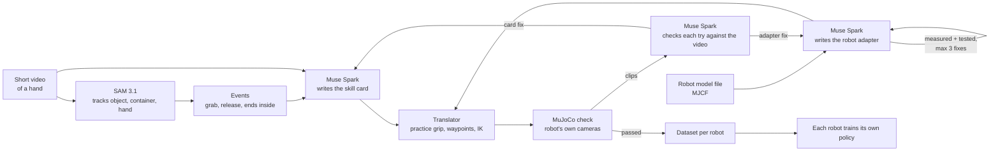
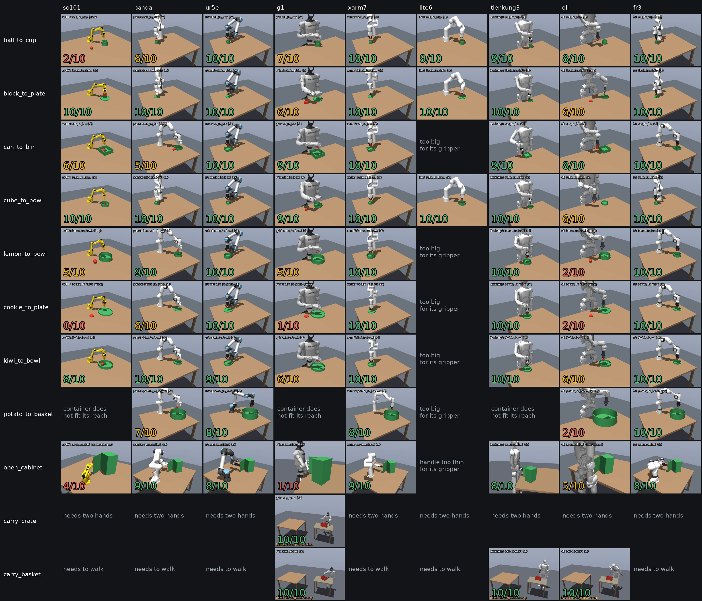
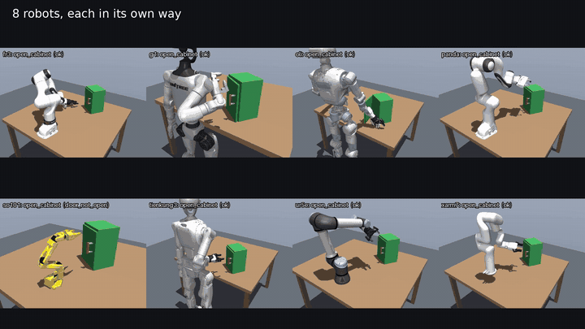
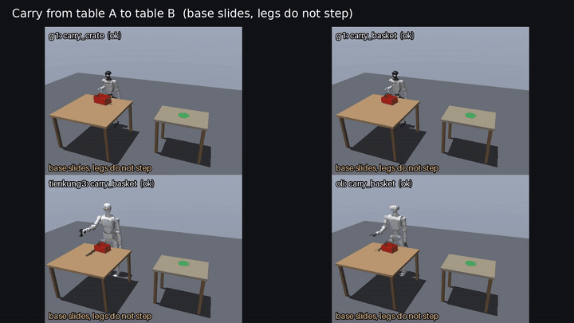
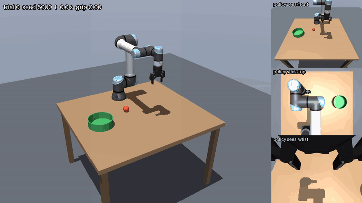
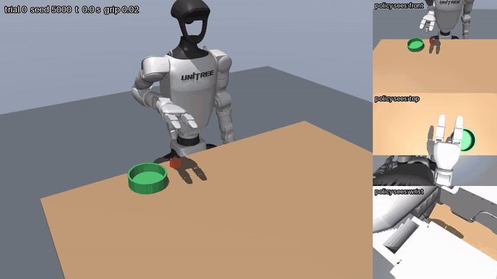

# Translator

A translator for robot skills. Film a task once, and any robot can learn it: Meta AI turns the video into a skill card, the skill is translated into each robot's own motions, checked in simulation, and trained per robot.



*A 3-second video of a hand putting a lemon into a bowl. SAM 3.1 tracks the objects, Muse Spark writes the skill card, and robots that look nothing alike each do it in their own way. [Full video (mp4)](docs/media/reel.mp4)*

## The idea

Today every robot has to be taught every task on its own, with hours of demos per robot. Translator copies the **meaning** of a task, not the motion.

A **skill card** says what has to happen: the objects, the grip, the steps and how to check success. It says nothing about joints or arm paths. The translator reads each robot's model file (reach, gripper, joint limits), turns the card into that robot's own motion, and proves it in simulation. A small arm and a humanoid can't move the same way, but both can reach the same goal.

Two stages, like a class with a teacher:

1. **Learn once (the hard part):** video → skill card. Done once per task.
2. **Repeat on every robot (the cheap part):** card → each robot's motion, checked in simulation. Done once per robot, no new demos.

```json
{
  "name": "lemon_to_bowl",
  "goal": "A lemon is inside the wooden bowl.",
  "objects": {
    "lemon": {"shape": "sphere", "size": [0.055, 0.055, 0.055]},
    "wooden_bowl": {"shape": "bowl", "inner_radius": 0.1, "wall_height": 0.07}
  },
  "grip": {"object": "lemon", "approach": "top", "between": "around", "width": 0.055},
  "steps": ["reach above lemon", "descend", "close", "lift 15 cm", "carry above bowl", "lower", "open", "retreat"],
  "success": {"test": "inside", "object": "lemon", "container": "wooden_bowl"}
}
```
*(written by Muse Spark from the video; steps shortened here, the real card is [cards/lemon_to_bowl.json](cards/lemon_to_bowl.json))*

## How it works



- **Video → card (Meta AI):** Muse Spark first decides the kind of task (pick and place, open a door, carry), then names the moved object and the container. SAM 3.1 tracks them and the hand in every frame. From the tracks we read which object moved, when it was grabbed and released, and whether it ended inside the container. Muse Spark watches the video with these facts and writes the card (structured JSON output).
- **Model file → adapter (Meta AI):** for a robot the code has never seen, Muse Spark reads its model file and writes the adapter: grip point, which way the hand points and closes, gripper open/close values, start pose, where the robot stands. The translator then **measures** the adapter (where the hand really points, which way the fingers move, how wide the gripper opens, what the hand bumps into, how high the robot stands) and **tests** it on two skills. If it fails, the numbers, the failures and three replay frames go back to Muse, which fixes the adapter. At most 3 fixes.
- **Needs:** the card also says what the task needs: hands, how far the person walks, weight. Each robot checks this against its own body first and says no with a reason ("needs two hands", "must walk", "too heavy", "too big for its gripper") instead of trying.
- **Practice:** the card says where to hold an object, not how deep each gripper must go (a Robotiq closes on an arc, the SO-101 has one fixed jaw, a lemon rolls where a cube sits). Before a robot is tested, it tries a few grip depths on practice layouts and keeps the one that holds.
- **Vision:** every robot has a front, a top and a wrist camera, and finds the objects in its own images (colour + depth), not from the simulator.
- **IK + physics:** [mink](https://github.com/kevinzakka/mink) solves every control step (25 Hz) with joint speed limits and keeps the arm away from the robot's own body, then MuJoCo runs it with the robot's own motors. Nothing is moved by hand.
- **Check and improve (Meta AI):** Muse Spark watches each robot's failed try next to the human video, says what went wrong and if the fix is in the card or in that robot, and proposes card changes. A change is kept only if more tries pass on the same layouts.
- **Data + training:** checked runs become a [LeRobot](https://github.com/huggingface/lerobot) dataset per robot (state, action, 3 camera images), and each robot trains its own ACT policy.

## Results

### Video → skill card

| Video | SAM 3.1 + Muse Spark | Time | Meta API cost |
|---|---|---|---|
| 3 s, one lemon into a bowl | card: lemon 5.5 cm, bowl r 10 cm, grab 1.0 s, release 1.8 s | 56-71 s (2 runs) | $0.07 |
| 30 s, 13 lemons on the table, one is moved | SAM tracks all 13, the one that moved is found; same card | 169 s | $0.49 |
| 3.6 s, top view, a cookie from a tray onto a plate | cookie (6 cm disc, 1.5 cm thick), plate r 11 cm | 76 s | $0.07 |
| 5 s, a kiwi put on top of the fruit in a bowl | kiwi 5 cm, bowl r 11 cm, test "on top" | 52 s | $0.09 |
| 4.5 s, a potato into a wire basket | potato 5 cm, basket r 20 cm, wall 15 cm | 85 s | $0.08 |
| 3.5 s, a woman opens a glass cabinet door | kind "open": cabinet 1.2 x 1.9 m, door 55 cm, open 70° | 60 s | $0.07 |
| 3.7 s, a woman moves a box with both hands | needs: 2 hands, about 2 kg, moved 0.8 m | 82 s | $0.08 |

The cabinet from the video is real furniture: its door swings wider than any of the arms can reach, so every robot says "no room". The box needs two hands and is wider than the grippers, so every robot says no, each with its reason.

### Robots the code had never seen

Muse writes the adapter from the model file alone. Test = 5 trials of `cube_to_bowl` + 5 of `block_to_plate` (a long block gripped across its narrow side, so a wrong closing axis shows up), with camera vision.

| Robot | What it is | Adapter written by | Fix rounds | Test | Meta API cost |
|---|---|---|---|---|---|
| uFactory xArm7 | 7-joint arm with its own gripper | Muse Spark 1.3 | 0 | 10/10 | $0.02 |
| UR5e | arm without a gripper; Muse picked the Robotiq 2F-85 from the tool list | Muse Spark 1.3 | 0 | 10/10 | $0.02 |
| uFactory Lite6 | small arm with its own small gripper | **Muse Spark Open** (open weights, Baseten) | 0 | 10/10 | - (9 s) |
| TienKung 3 (X-Humanoid) | humanoid; Robotiq fitted to its wrist | Muse Spark 1.3 | 0 | 10/10 | $0.05 |
| Franka FR3 | arm without a gripper; Muse picked the Robotiq | **Muse Spark Open** (open weights, Fireworks) | 0 | 10/10 | - (21 s) |
| LimX Oli | humanoid with LimX's own gripper | Muse Spark 1.3 | 3 | 9/10 | $0.27 |
| PAL TALOS | humanoid with its own three-finger gripper | Muse Spark 1.3 | 3 | 1/10, not added | $0.25 |
| Booster T1 | humanoid with 4-joint arms (no wrist) | Muse Spark 1.3 | 3 | 1/10, not added | $0.20 |

LimX ships Oli's gripper only as URDF, so [`scripts/limx_gripper.py`](scripts/limx_gripper.py) puts their wrist and gripper on their MuJoCo model. In round 2 the robot cut into the table, which counts 0. TALOS and Booster T1 did not pass: TALOS's gripper closes only to about 37 mm at the grip point Muse chose, and the T1's arm has no wrist, so it cannot point a gripper down. A robot is only added to the library when it passes; every robot must also stand clear of the table.

My hand-written UR5e adapter and the one Muse wrote have the same grip axes, and both get 50/50 on all five skills below.

### Skill library × robot library

Every skill on every robot, 10 random layouts each, camera vision. A trial counts only if the object ends up where the card says (in the container, door open 60°, crate on table B). Four skills were written by Muse Spark from short stock videos of a hand (lemon, cookie, kiwi, potato); the others are hand-written.



| skill \ robot | SO-101 | Panda | UR5e | G1 | xArm7* | Lite6* | TienKung 3* | Oli* | FR3* |
|---|---|---|---|---|---|---|---|---|---|
| ball_to_cup | 2/10 | 6/10 | 10/10 | 7/10 | 10/10 | 9/10 | 9/10 | 8/10 | 10/10 |
| block_to_plate | 10/10 | 10/10 | 10/10 | 6/10 | 10/10 | 10/10 | 10/10 | 6/10 | 10/10 |
| can_to_bin | 6/10 | 5/10 | 10/10 | 9/10 | 10/10 | too big | 9/10 | 8/10 | 10/10 |
| cube_to_bowl | 10/10 | 10/10 | 10/10 | 9/10 | 10/10 | 10/10 | 10/10 | 6/10 | 10/10 |
| lemon_to_bowl (video) | 5/10 | 9/10 | 10/10 | 5/10 | 10/10 | too big | 10/10 | 2/10 | 10/10 |
| cookie_to_plate (video) | 0/10 | 6/10 | 10/10 | 1/10 | 10/10 | too big | 10/10 | 2/10 | 10/10 |
| kiwi_to_bowl (video) | 8/10 | 10/10 | 9/10 | 6/10 | 10/10 | too big | 10/10 | 6/10 | 10/10 |
| potato_to_basket (video) | no room | 7/10 | 8/10 | no room | 8/10 | too big | no room | 2/10 | 10/10 |
| open_cabinet | 4/10 | 9/10 | 8/10 | 1/10 | 9/10 | too thin | 8/10 | 5/10 | 8/10 |
| carry_crate | two hands | two hands | two hands | 10/10 | two hands | two hands | two hands | two hands | two hands |
| carry_basket | must walk | must walk | must walk | 10/10 | must walk | must walk | 10/10 | 10/10 | must walk |

\* adapter written by Muse from the model file. (video) = skill card written by Muse Spark from a video. Total: **611/760 trials (80 %)** in the 76 cells a robot can try. The other cells are measured, not tried: "too big" / "too thin" = the gripper can't open or close that far, "no room" = the objects don't both fit in its reach, "two hands" = the robot has one, "must walk" = the second table is out of reach and the robot can't move.

The SO-101 is a small arm, and the lemon and the ball are near the limit of its jaw. Most other misses are a round object rolling or slipping out on the way.

### Open a door, carry between tables



*A cabinet door on a real hinge: grip the handle, pull along the arc while the hand turns with the door. 7 of 9 robots can do it.*



*G1 carries a crate with both hands; G1, TienKung 3 and Oli carry a basket by its top handle. Humanoids move between the tables with a sliding base, the legs don't step: a real humanoid walks with its own controller, the translator only says where to go. Arms can't move, so they say "must walk".*

### Check and improve

First run on the cookie skill (2 rounds, $0.17): Muse got the problem right for 4 of 5 robots ("closes on the cookie but never holds it; the person pinches it at the edge") and made the grip width smaller. That changed nothing (50 tries passed before and after), so the card stayed the same. The grip width only sets how far the gripper opens, so Muse now gets a short list of what each field does and what was already tried.

### Trained policies



*The UR5e's own policy, trained on the lemon skill from the video, on a layout it never saw. Right: what it sees (front, top and wrist camera). No planner, no IK: camera images and joint angles in, motor commands out.*



*The same for the G1 humanoid: its own policy, trained on its own checked runs of the cube skill, 37 of 50 new layouts.*

Each robot's checked runs become a LeRobot dataset (200 episodes: joint states, actions, front/top/wrist images), and one ACT policy per robot learns from it. The policy is then tested on 50 new layouts it never saw, with nothing but its own cameras and joint states.

| Robot | Skill | Dataset | Training | Test on new layouts |
|---|---|---|---|---|
| SO-101 | cube_to_bowl | 200 episodes (200 of 212 tries passed the check) | 40k steps, about 45 min | **24/50 (48 %)**; 5/20 after 10k steps |
| UR5e | lemon_to_bowl (the skill from the video) | 200 episodes (200 of 203) | 40k steps, about 40 min | **35/50 (70 %)** |
| Panda | cube_to_bowl | 200 episodes (200 of 216) | 40k steps, about 40 min | **19/50 (38 %)** |
| G1 (humanoid) | cube_to_bowl | 200 episodes (200 of 236) | 40k steps, about 40 min | **37/50 (74 %)** |
| xArm7 (adapter by Muse) | lemon_to_bowl (the skill from the video) | 200 episodes (200 of 202) | 40k steps, about 42 min | **33/50 (66 %)** |
| FR3 (adapter by Muse) | lemon_to_bowl (the skill from the video) | 200 episodes (200 of 205) | 40k steps, about 44 min | **26/50 (52 %)** |
| TienKung 3 (adapter by Muse) | lemon_to_bowl (the skill from the video) | 200 episodes (200 of 229) | 40k steps, about 40 min | **29/50 (58 %)** |

## Swap robots and skills

A robot is one JSON file in [`robots/`](robots/) (hand-written) or [`robots/muse/`](robots/muse/) (written by Muse). A skill is one JSON file in [`cards/`](cards/). Pick any pair:

```bash
.venv/bin/python scripts/watch.py --list                                      # what is in the libraries
.venv/bin/python scripts/watch.py tienkung3 oli --skill lemon_to_bowl can_to_bin  # live 3D view
.venv/bin/python scripts/matrix.py --robots so101 xarm7 --skills ball_to_cup     # numbers + clips
```

Add a new robot from its model file:

```bash
.venv/bin/python scripts/write_adapter.py <model.xml under assets/robots> --name myrobot [--model baseten|fireworks]
```

Or in the browser (runs on your own PC for now): `scripts/web.sh`, then open http://127.0.0.1:8000. Upload a video, see what Meta AI understood, see which robots can do it, pick some and watch them try.

Teach a new skill from a video:

```bash
.venv/bin/python scripts/run_job.py my_video.mp4 --check   # card + which robots can do it, in seconds
.venv/bin/python scripts/run_job.py my_video.mp4 --robots-only --robots ur5e g1 --train   # only the robots you pick
.venv/bin/python scripts/run_job.py my_video.mp4           # every robot tries it, reel.mp4 in outputs/jobs/<video>/
.venv/bin/python scripts/review_job.py outputs/jobs/<video> # Muse checks the tries and improves the card
```

## Run it

Linux with an NVIDIA GPU (tested on an RTX 3090). The Meta Model API key (`MODEL_API_KEY`) and, for Muse Spark Open, a Baseten or Fireworks key (`BASETEN_API_KEY`, `FIREWORKS_API_KEY`) go into `.env`.

```bash
conda create -p .venv -c conda-forge --override-channels python=3.12 ffmpeg=7.1.1
.venv/bin/pip install mujoco mink daqp numpy imageio imageio-ffmpeg pillow "lerobot[dataset,training]"
scripts/fetch_robots.sh                                   # robot models into assets/robots/

MUJOCO_GL=egl .venv/bin/python scripts/smoke_test.py      # MuJoCo, mink, rendering
.venv/bin/python scripts/check_robots.py                  # every robot loads, moves, cameras work
.venv/bin/python scripts/kill_test.py so101 panda g1 --n 10 --card cards/cube_to_bowl.json
.venv/bin/python scripts/make_dataset.py so101 --card cards/cube_to_bowl.json --episodes 200
.venv/bin/python scripts/eval_policy.py so101 --card cards/cube_to_bowl.json --policy <checkpoint>/pretrained_model
```

## Repo

| Path | What |
|---|---|
| `cards/` | skill library |
| `robots/`, `robots/muse/` | robot library: one adapter per robot |
| `translator/meta.py`, `events.py`, `card_writer.py` | SAM 3.1 + Muse Spark calls, events from the tracks, the card |
| `translator/blueprint.py`, `adapter_writer.py` | model file facts, adapter measurements, Muse writes and fixes adapters |
| `translator/scene.py` | table, objects, robot, cameras; reach, footprint and fingertips measured from the model |
| `translator/practice.py` | grip practice |
| `translator/perceive.py` | finds the card's objects in the camera images |
| `translator/translate.py`, `ik.py`, `execute.py` | card + adapter → waypoints → IK at every step → physics run, success test |
| `translator/carry.py`, `mobile.py` | carry kind: crate and basket, sliding base between tables |
| `translator/review.py` | Muse checks robot tries against the video and changes the card |
| `web/` | local web app: JSON API + one page |
| `scripts/` | jobs, matrix, adapters, datasets, training eval, live viewer, media |

## Next

- Film our own videos (more skills), and a real hand-held phone video
- Check and improve: more card fields (for example a pinch at the edge), more rounds
- Two hands without handles (squeeze a box between the palms), a humanoid that steps back while it opens a full-size door
- Better policies: recovery data (push the teacher off course and record the correction), longer training, fine-tune SmolVLA
- Training for the door and carry skills
- Run everything in the cloud, then a web tool: upload a short video, pick robots, watch each one do the task

## Credits

Built during the [Meta Global AI Developer Hackathon](https://cerebralvalley.ai/e/meta-ai-developer-hackathon/details) (26 Oct - 4 Nov 2026). Meta models: SAM 3.1 and Muse Spark 1.3 (Meta Model API), Muse Spark Open (open weights, on Baseten and Fireworks).

Robot models (downloaded by `scripts/fetch_robots.sh`, not stored in this repo, each keeps its own license): [MuJoCo Menagerie](https://github.com/google-deepmind/mujoco_menagerie) (Franka Panda and FR3, UR5e, Robotiq 2F-85, Unitree G1, uFactory xArm7 and Lite6, PAL TALOS, Booster T1), [SO-ARM100](https://github.com/TheRobotStudio/SO-ARM100) (SO-101), [LimX Dynamics humanoid-description](https://github.com/limxdynamics/humanoid-description) (Oli and its gripper, Apache-2.0), [X-Humanoid xSIM_MUJOCO](https://github.com/Open-X-Humanoid/xSIM_MUJOCO) (TienKung 3, Apache-2.0).

Test videos (Pexels License): "Person Putting Orange in Bowl" by SHVETS production ([Pexels](https://www.pexels.com/video/person-putting-orange-in-bowl-7198787/)), "A Person Transferring Cookies on the Plate" by Polina Tankilevitch ([Pexels](https://www.pexels.com/video/a-person-transferring-cookies-on-the-plate-4110527/)), "Person Putting a Kiwi on Bowl of Fruits" by Kaboompics ([Pexels](https://www.pexels.com/video/person-putting-a-kiwi-on-bowl-of-fruits-6989169/)), "A Person Putting Potato in a Basket" by Tima Miroshnichenko ([Pexels](https://www.pexels.com/video/a-person-putting-potato-in-a-basket-7876937/)), "Young Woman Taking Mug out of Cupboard" by Ivan S ([Pexels](https://www.pexels.com/video/young-woman-taking-mug-out-of-cupboard-5515109/)), "A woman is moving boxes in a room" by cottonbro studio ([Pexels](https://www.pexels.com/video/a-woman-is-moving-boxes-in-a-room-4554453/)).

Simulation with [MuJoCo](https://github.com/google-deepmind/mujoco), IK with [mink](https://github.com/kevinzakka/mink), learning with [LeRobot](https://github.com/huggingface/lerobot).
