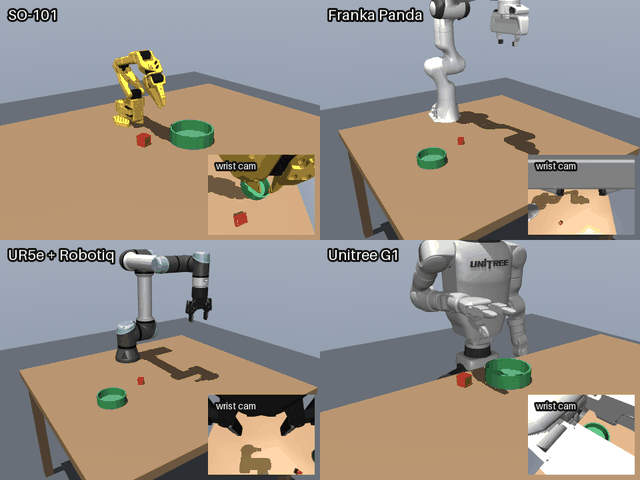
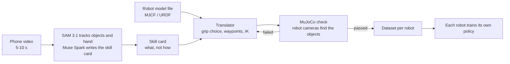
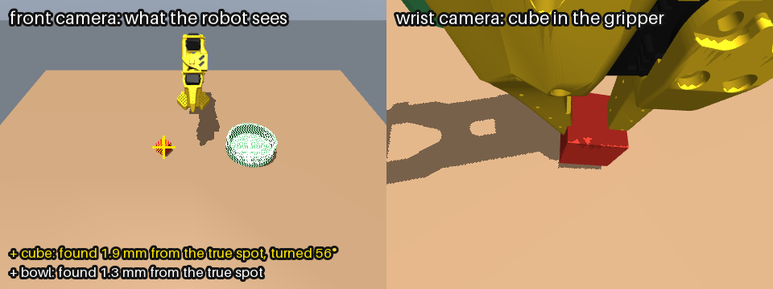
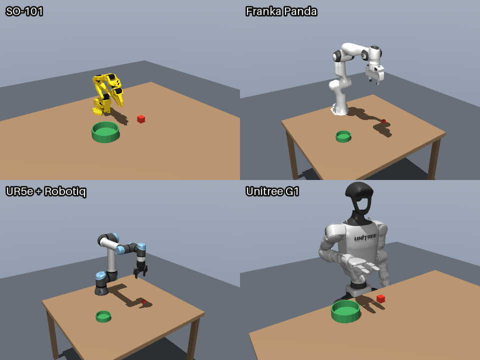

# Translator

A translator for robot skills. Film a task once with your phone, and any robot can learn it: the skill is translated into each robot's own motions, checked in simulation, and trained per robot.



*One hand-written skill card, four robots that look nothing alike, each in its own way: SO-101, Franka Panda, UR5e and the Unitree G1 humanoid. The small picture is each robot's wrist camera. [Full video (mp4)](docs/media/hero.mp4)*

## The idea

Today every robot has to be taught every task on its own, with hours of demos per robot. Translator copies the **meaning** of a task, not the motion.

A **skill card** says what has to happen: the objects, the grip, the steps and how to check success. It says nothing about joints or arm paths. The translator reads each robot's model file (reach, gripper, joint limits), turns the card into that robot's own motion, and proves it in simulation. A small arm and a humanoid can't move the same way, but both can reach the same goal.

```json
{
  "name": "cube_to_bowl",
  "goal": "the cube ends up inside the bowl",
  "objects": {
    "cube": {"shape": "box", "size": [0.03, 0.03, 0.03]},
    "bowl": {"shape": "bowl", "inner_radius": 0.06, "wall_height": 0.04}
  },
  "grip": {"object": "cube", "approach": "top", "between": "opposite faces", "width": 0.03},
  "steps": ["reach above cube", "descend", "close", "lift 10 cm", "carry above bowl", "lower", "open", "retreat"],
  "success": {"test": "inside", "object": "cube", "container": "bowl"}
}
```
*(steps shortened here, the real card is [cards/cube_to_bowl.json](cards/cube_to_bowl.json))*

## How it works



What already runs (the card is still hand-written, the Meta model steps come next):

- **Vision:** every robot has a front, a top and a wrist camera. The robot finds the cube and the bowl in its own images (colour + depth), not from the simulator. On average the cube is found 2.5 mm from its true spot, the bowl 2 mm.
- **Translator:** card + robot adapter → gripper waypoints. Heights come from the object sizes. The translator tries all four ways to grip the cube and picks one this body can actually reach.
- **IK + physics:** [mink](https://github.com/kevinzakka/mink) solves every control step (25 Hz) with joint speed limits and keeps the forearm and hand away from the robot's own body, then MuJoCo runs it with the robot's own motors. Nothing is moved by hand.
- **Hands, not just grippers:** the G1's three-finger hand is driven as one "gripper" with an open and a closed pose. Its pinch was designed with a search over hand poses (thumb and index finger meet two opposite faces of the cube at the same time, flat pads, nothing hits the table) and then checked in physics, see `scripts/grasp_design/`.



## Results so far

**Status, 26-27 Oct 2026 (day 1):** all four robots pass the kill test with their own camera vision, including the G1 humanoid with its three-finger hand. The Meta model steps (video → skill card, model file → adapter) come next.

The kill test puts the cube and the bowl at random places inside each robot's reach. A trial counts only if the cube ends up inside the bowl.

| Robot | Kill test, 10 fixed layouts | 50 new layouts |
|---|---|---|
| SO-101 | 10/10 | 48/50 |
| Franka Panda | 10/10 | 44/50 |
| UR5e + Robotiq 2F-85 | (not in the kill test) | 48/50 |
| Unitree G1 + Dex3 hand (pelvis fixed, right arm) | 9/10 | 47/50 |

Most failures are the cube slipping out of the gripper on the way to the bowl. The Panda model's gripper squeezes a 3 cm cube with only about 1.5 N. Two of the three G1 misses are a bowl or cube across its body, where its right arm would have to go through its own torso; the third is a missed grasp.



## Run it

Linux with an NVIDIA GPU (tested on an RTX 3090).

```bash
conda create -p .venv -c conda-forge --override-channels python=3.12 ffmpeg=7.1.1
.venv/bin/pip install mujoco mink daqp numpy imageio imageio-ffmpeg pillow "lerobot[dataset,training]"
scripts/fetch_robots.sh                                   # robot models into assets/robots/

MUJOCO_GL=egl .venv/bin/python scripts/smoke_test.py      # MuJoCo, mink, rendering
.venv/bin/python scripts/check_robots.py                  # every robot loads, moves, cameras work
.venv/bin/python scripts/kill_test.py so101 panda g1 --n 10  # results + videos in outputs/kill_test/
.venv/bin/python scripts/watch.py                         # live 3D view: G1, SO-101, Panda, UR5e + their cameras
.venv/bin/python scripts/make_media.py                    # the pictures and video in this README
```

## Repo

| Path | What |
|---|---|
| `cards/` | skill cards |
| `translator/robots.py` | robot adapters: gripper point, grip axes, open/close values, home pose |
| `translator/scene.py` | table, cube, bowl, robot, cameras; reach and footprint measured from the model |
| `translator/perceive.py` | finds the card's objects in the camera images |
| `translator/translate.py` | skill card + adapter → waypoints |
| `translator/ik.py`, `translator/execute.py` | IK at every step, physics run, success test |
| `scripts/` | kill test, live viewer, robot check, media |
| `scripts/grasp_design/` | hand test rig + grasp pose search (how the G1 pinch was found) |

## Next

- Muse Spark + SAM 3.1: phone video → skill card
- Muse reads a robot's model file and writes its adapter, and fixes a failed translation from the replay
- LeRobot datasets from the checked runs, one ACT policy per robot
- A robot the code has never seen, from its model file alone
- A web tool: upload a short video, pick robots from the library or upload your own, and watch each one do the task

## Credits

Built during the [Meta Global AI Developer Hackathon](https://cerebralvalley.ai/e/meta-ai-developer-hackathon/details) (26 Oct - 4 Nov 2026).

Robot models: [MuJoCo Menagerie](https://github.com/google-deepmind/mujoco_menagerie) (Franka Panda, UR5e, Robotiq 2F-85, Unitree G1) and [SO-ARM100](https://github.com/TheRobotStudio/SO-ARM100) (SO-101). Each model keeps its own license; they are downloaded by `scripts/fetch_robots.sh` and not stored in this repo. Simulation with [MuJoCo](https://github.com/google-deepmind/mujoco), IK with [mink](https://github.com/kevinzakka/mink), learning with [LeRobot](https://github.com/huggingface/lerobot).
